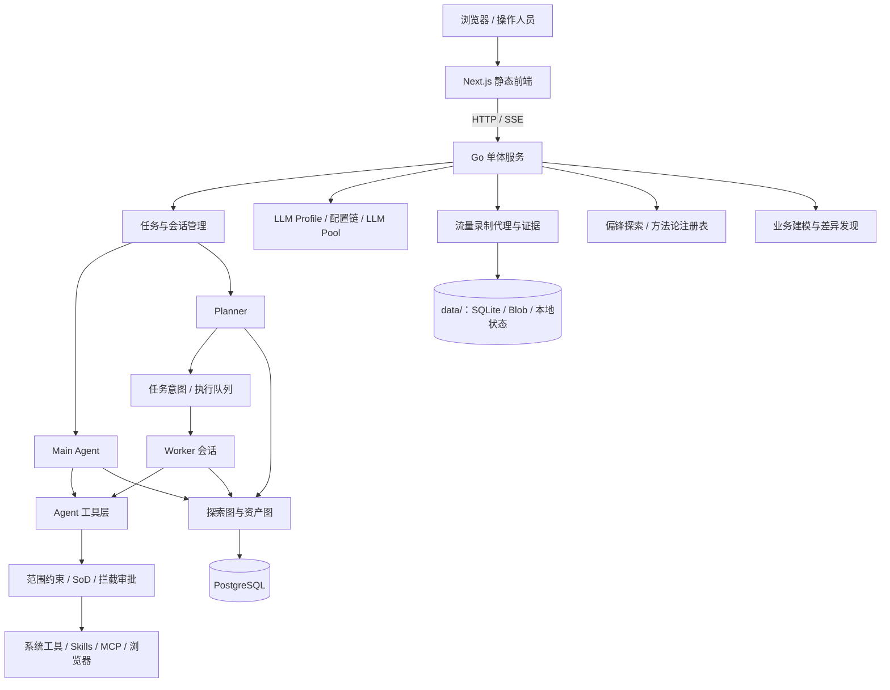

# reArtex

**一个以安全边界为核心的 AI 辅助渗透测试与攻击面验证平台。**

reArtex 是基于 ARTEX 演进的独立安全加固分支。项目采用 Go 单体后端、内嵌 Next.js 静态前端和 PostgreSQL，Agent 能力由 `norma` SDK 提供。它围绕任务规划、工具执行、资产与探索图、发现管理、业务逻辑验证、流量留证和可审计的操作控制构建完整工作流。

> **当前版本：`v0.15.11`**  
> 当前版本号以仓库根目录 `VERSION` 文件及 GitHub Release 为准。  
> **项目仍在快速演进中。** README 中的“当前能力”对应仓库已发布实现；“后续演进方向”是架构路线，不代表已经合并到当前版本。

<p align="center">
  <a href="https://github.com/wufufu770/reArtex/releases">Releases</a> ·
  <a href="https://github.com/wufufu770/reArtex/blob/main/CHANGELOG.md">Changelog</a> ·
  <a href="https://github.com/wufufu770/reArtex/blob/main/RELEASE_NOTES.md">Release Notes</a> ·
  <a href="https://github.com/wufufu770/reArtex/issues">Issues</a>
</p>


---

## 目录

- [项目定位](#项目定位)
- [当前能力](#当前能力)
- [系统架构](#系统架构)
- [技术栈](#技术栈)
- [快速开始](#快速开始)
  - [Docker Compose 部署（推荐）](#docker-compose-部署推荐)
  - [预编译版本](#预编译版本)
  - [从源码构建](#从源码构建)
- [首次使用](#首次使用)
- [配置说明](#配置说明)
- [运行与维护](#运行与维护)
- [目录结构](#目录结构)
- [后续演进方向](#后续演进方向)
- [安全使用边界](#安全使用边界)
- [贡献与反馈](#贡献与反馈)
- [许可证](#许可证)

---

## 项目定位

reArtex 不只是一个调用命令行工具的 LLM 外壳。它把测试任务、执行意图、资产、事实、漏洞发现、HTTP 流量和审计记录组织成可以持续查询与复核的数据系统。

项目当前有三个主要目标：

1. **让 Agent 能够推进真实的测试任务。** 将用户目标拆解为可执行意图，由任务运行时协调 Main Agent、Planner 和 Worker 完成分析、工具调用、结果回写和后续规划。
2. **让测试过程可追踪、结果可复核。** 执行过程、资产关系、发现、请求响应和审批记录都进入持久化存储，避免结论只存在于一次 LLM 对话中。
3. **让自动化服从明确的安全边界。** 任务范围、工具审查、操作约束、审批、数据库权限和审计机制共同构成执行控制面。

reArtex 维护自己的版本与发布线，不自动跟随上游 ARTEX 的代码变更。

## 当前能力

以下能力来自当前仓库代码、`CHANGELOG.md` 和 `v0.15.11` 发布说明。

### 1. 任务编排与 Agent 执行

- **Main Agent**：面向用户的任务对话与编排入口，可读取任务态势、调用任务工具，并对运行中的 Worker 进行 `steer` 纠偏。
- **Planner**：结合目标、探索图和当前任务上下文拆解目标、生成或调整执行意图。
- **Worker**：领取意图并调用工具执行，将新资产、事实、发现和执行记录写回任务状态。
- **任务控制**：支持任务暂停、恢复、取消和并发准入；运行中的 Worker 支持单项控制，任务并发上限可配置，排队任务按 FIFO 准入。
- **任务继承**：新任务可以关联多个来源任务，并只读继承直接来源任务的目标、事实、漏洞、已完成意图、资产范围和上下文；新任务仍保持独立的执行队列、工作目录和对话历史。
- **LLM 用量记录**：按任务、会话、模型和配置统计输入、输出及缓存 Token，并记录运行轮次、耗时、终止原因等执行信息。

> 当前发布版本仍然包含 Main Agent、Planner 和 Worker 等既有运行角色。后续计划中的 Single-Agent 主执行架构尚不能视为 `v0.15.11` 已交付能力。

### 2. 双图数据模型：探索图与资产图

reArtex 用两类图表达不同层次的信息：

- **探索图（Exploration Graph）**：记录单个任务的目标、意图、执行推进、事实、发现及其关系，回答“这个任务做过什么、为什么继续这样做”。
- **资产图（Asset Graph）**：跨任务维护共享资产及其关系，支持企业、根域名、子域名、IP、服务和接口等资产的组织与查询。
- **锚点关联**：将任务探索过程与资产实体关联起来，可以从任务探索方向追踪涉及的资产，也可以从资产反查相关任务和执行记录。
- **企业与任务范围**：支持企业资产范围、任务测试资产和来源任务上下文；域名、URL、IP、CIDR、ICP 及企业关键词可按规则识别和使用。
- **覆盖度控制**：任务可选择是否启用资产覆盖度统计；顺带发现但不属于本任务覆盖范围的资产可单独标记，避免污染覆盖度数据。

### 3. 发现管理与漏洞复测

- 集中查看跨任务发现，支持按任务或资产组织与筛选。
- 发现记录可关联资产、执行轨迹、请求响应和证据。
- 支持编辑发现名称、类别、严重程度和处置状态。
- 支持从发现创建深入验证意图。
- 提供独立复测会话，复测结论区分**仍可复现、已修复、无法确认**，并保留历次结论与证据。
- 复测结果可以同步更新漏洞处置状态，避免只保留一次性的判断。

### 4. 偏锋探索与可编方法论

`/function/pianfeng` 提供独立的偏锋探索入口：

- 可直接布置偏锋探索任务，页面与 `POST /api/edge/run` 及 `edge_run` 工具使用同一宿主执行链。
- 展示真实运行记录、状态、判据进度和停止信息；运行中的任务可以停止。
- 内置方法论条目支持编辑名称、档位、证据级、判据、说明、标签和优先级。
- 内置条目覆盖采用 override 方式保存，并可恢复默认；自定义条目执行同类校验。
- 方法论启停和优先级、本体修改会进入运行时注册表，影响后续轮换与判定。

### 5. 业务建模与行为差异发现

业务建模能力维护两层模型：

- **Design**：系统或业务“声称应该如何工作”的设计层描述。
- **Behavior**：测试过程中观察到的实际行为。

当设计声明与实际行为之间存在可验证差异时，系统可以将差异转化为发现，形成“业务建模 → 行为验证 → 差异 → 发现”的闭环。建模可由发现或任务创建等事件触发。

### 6. 安全控制、范围约束与审计

reArtex 将工具执行控制放在 Agent 与底层工具之间，而不是只依赖提示词要求 Agent 自律。

- **范围约束**：任务可维护 allow/deny 操作约束，并将约束注入 Planner 与 Worker 的执行上下文。
- **SoD 审查链**：对工具意图和复合命令进行规整与审查；复合命令会按子动作检查，不能因为整体字符串通过就跳过内部动作判定。
- **命令拦截**：支持字符串/正则规则，并可在规则未命中时使用模型进行 `ALLOW` / `ASK` / `DENY` 语义判定；模型判定失败和审批超时按配置处理。
- **审批与复核**：保留审批门、复核过期控制和结构化审计结果；拒绝原因包含被拒绝的目标或操作信息。
- **路径与本地操作边界**：对工作目录写入、路径访问和本地操作进行区分，兼顾任务工作区操作与范围外访问控制。
- **数据库最小权限**：Docker 部署通过 `scripts/db-role-bootstrap.sh` 创建受限运行角色。运行期角色没有创建表、删除表或修改数据库结构的权限；启动迁移使用单独的管理连接。
- **凭据保护**：Docker Compose 使用 secret 文件传递数据库连接信息，避免将数据库口令直接暴露在容器环境变量配置面。
- **交付安全检查**：发布流程包含测试门、二进制版本校验、容器环境块检查、ptrace 能力检查和构建来源证明。

这些控制降低了误操作和权限越界风险，但不等同于对任意不可信工具、同 UID 子进程或宿主机的完整沙箱隔离。生产或高风险环境仍应采用独立主机/容器、网络策略和最小权限部署。

### 7. 流量记录与证据留存

- 提供独立 HTTP 流量录制代理，默认监听 `8788`。
- 将请求与响应作为完整 exchange 保存；大正文可进入按内容 hash 去重的 blob 存储。
- 支持流量全文检索，包括正文子串与中文检索。
- 工具执行、流量和发现之间保留关联，便于复核 Agent 的实际操作与结论。
- 大正文支持流式下载；历史数据保持兼容读取。

### 8. LLM、模型兼容与故障切换

- 支持 Anthropic、OpenAI Chat Completions 和 OpenAI Responses 等请求格式。
- 模型请求形状由 profile 配置驱动，包括 thinking、reasoning effort、stream、输出 Token 字段和上下文窗口等。
- 支持为任务配置有序 LLM 配置链，并在识别到供应商额度耗尽等明确情形时切换到下一配置。
- 支持全局 LLM Pool、健康状态、失败兜底、冷却恢复和手动重置。
- 可按角色绑定模型；角色绑定、任务配置链和全局配置按既定优先级解析。
- 支持流式与非流式调用、用量账本和配置连通性测试。

### 9. MCP、Skills 与浏览器工具

- 支持本地 Skills 目录和技能管理。
- 支持远程 MCP 的 Streamable HTTP（`http`）和旧版 SSE（`sse`）连接模式。
- Docker 镜像预装 Playwright MCP / CLI 与 Chromium，减少首次使用浏览器工具时的运行时下载步骤。
- 镜像当前对公开 Skills 做构建期白名单校验，避免本地私有技能被意外打包进公开镜像。

### 10. 报告、备份与交付设施

- 提供任务、发现、执行过程和流量等数据的管理界面。
- `backup.sh` 支持导出 PostgreSQL、工作目录和审计链头等备份内容。
- CI 包含 Go 编译、vet、测试与前端检查；端到端冒烟覆盖主要路由。
- Release 支持 Linux、macOS、Windows 多平台二进制打包，并提供 `SHA256SUMS`、SBOM 和构建来源证明。
- Docker 镜像发布到 GitHub Container Registry，并执行发布后启动冒烟检查。

---

## 系统架构



### 关键组件

| 组件                      | 主要职责                                    |
| ------------------------- | ------------------------------------------- |
| `web/`                    | Next.js 前端，静态导出后由 Go 服务内嵌      |
| `server/`                 | HTTP API、SSE、鉴权、任务与服务生命周期管理 |
| `agent/`                  | Agent 角色、提示词、执行逻辑与工具定义      |
| `db/`                     | PostgreSQL schema、数据访问与权限脚本       |
| `guard/`、`intercept/`    | 工具执行控制、审查与审批                    |
| `netguard/`、`pathguard/` | 网络范围与路径访问控制                      |
| `traffic/`、`evidence/`   | HTTP 流量、证据记录与查询                   |
| `enrich/`                 | DNS、HTTP 等异步资产补全                    |
| `llmpool/`、`llmrec/`     | LLM 配置池、故障处理与调用记录              |
| `mcphttp/`、`skills/`     | MCP 接入与可扩展技能                        |
| `report/`                 | 报告与结果整理                              |
| `selfupdate/`             | 应用自更新与回滚流程                        |

---

## 技术栈

| 层             | 技术                                         |
| -------------- | -------------------------------------------- |
| 后端           | Go 1.26+                                     |
| Agent SDK      | `norma`                                      |
| 前端           | Next.js、React、TypeScript                   |
| 主数据库       | PostgreSQL 16                                |
| 流量与本地状态 | SQLite、Blob 文件                            |
| 实时通信       | HTTP API、SSE                                |
| 工具扩展       | Skills、MCP、Playwright                      |
| 部署           | Docker Compose、单二进制                     |
| 发布           | GitHub Actions、GHCR、SBOM、Build Provenance |

---

## 快速开始

### Docker Compose 部署（推荐）

适合希望快速获得完整运行环境的用户。Docker 镜像包含 Go 单二进制、内嵌前端和常用测试工具；PostgreSQL 作为独立服务运行。

#### 1. 获取代码并配置环境

```bash
git clone https://github.com/wufufu770/reArtex.git
cd reArtex

cp .env.example .env
```

编辑 `.env`，至少设置一个足够强的数据库密码：

```dotenv
ARTEX_TAG=v0.15.11

POSTGRES_USER=artex
POSTGRES_PASSWORD=请替换为强随机密码
POSTGRES_DB=artex

# 可选：也可以在首次登录后从 Web UI 配置 LLM
ANTHROPIC_API_KEY=
OPENAI_API_KEY=
ARTEX_LLM_PROVIDER=
ARTEX_LLM_MODEL=
ARTEX_LLM_BASE_URL=
ARTEX_LLM_PROXY=
```

想跟随最新镜像时可以将 `ARTEX_TAG` 设置为 `latest`；正式或长期环境建议固定到明确版本。

#### 2. 启动 PostgreSQL

```bash
docker compose up -d postgres
```

等待 PostgreSQL 健康检查通过：

```bash
docker compose ps
```

#### 3. 初始化数据库 schema 与最小权限账号

当前 Docker Compose 部署使用受限的运行期数据库角色。首次部署需要运行仓库提供的 bootstrap 脚本：

```bash
ARTEX_PG_CONTAINER="$(docker compose ps -q postgres)" \
  ./scripts/db-role-bootstrap.sh
```

该脚本会：

1. 应用 PostgreSQL schema；
2. 创建或刷新受限运行角色（默认 `artex_app`）；
3. 授予业务运行所需的最小权限；
4. 生成运行期数据库 secret `secrets/pg_dsn`；
5. 生成启动迁移使用的管理 secret `secrets/pg_dsn_admin`。

secret 文件权限为 `0600`，不要提交到 Git，也不要将文件内容粘贴到 Issue 或聊天中。

> 如果你修改了数据库超级用户密码、重建了 PostgreSQL 数据卷或切换数据库实例，需要重新运行 bootstrap 脚本，使 secret 与当前数据库凭据一致。

#### 4. 启动 reArtex

```bash
docker compose up -d artex
```

查看状态与日志：

```bash
docker compose ps
docker compose logs -f artex
```

浏览器打开：

```text
http://localhost:8787
```

默认端口：

| 端口   | 用途              | 默认绑定    |
| ------ | ----------------- | ----------- |
| `8787` | Web UI 与 API     | `0.0.0.0`   |
| `8788` | HTTP 流量录制代理 | `127.0.0.1` |

### 预编译版本

从 [GitHub Releases](https://github.com/wufufu770/reArtex/releases) 下载对应平台的 zip 包。

当前发布工作流提供：

- Linux amd64
- Linux arm64
- macOS amd64
- macOS arm64
- Windows amd64

解压后包含可执行文件、启动脚本、Skills 和配置示例。

1. 准备 PostgreSQL 数据库。
2. 将 `config.example.json` 复制为 `config.json`，填写数据库连接信息。
3. 根据需要设置 LLM 环境变量，或在 UI 中配置 LLM。
4. 使用启动脚本运行：

Linux / macOS：

```bash
chmod +x start.sh
./start.sh
```

Windows：

```bat
start.bat
```

建议通过 `start.sh` / `start.bat` 启动，而不是直接运行 `artex`。启动脚本负责信号转发、异常退出后的退避重启，以及应用更新/回滚所需的重新拉起流程。

### 从源码构建

#### 环境要求

- Go 1.26 或更高版本
- Node.js 20 或更高版本与 npm
- PostgreSQL 16（或兼容版本）
- `rsync`（使用仓库 `build.sh` 构建前端资源时需要）
- Linux / macOS 开发环境；Windows 可通过 WSL 等兼容环境构建

#### 构建当前平台

```bash
git clone https://github.com/wufufu770/reArtex.git
cd reArtex

./build.sh
```

`build.sh` 会构建前端静态产物、同步到 `server/webui/dist`，再编译内嵌前端的 Go 二进制。默认产物位于 `dist/` 下的对应平台目录。

#### 构建发布包

```bash
./build.sh --release
```

该模式会构建支持的 Linux、macOS 和 Windows 目标，并生成 zip 发布包。可通过 `ARTEX_TARGETS` 覆盖目标列表；UPX 压缩为可选项，正式发布默认优先考虑二进制兼容性。

#### 手动构建（可选）

```bash
cd web
npm ci
npm run build:static
cd ..

mkdir -p server/webui/dist
rsync -a --delete web/out/ server/webui/dist/

CGO_ENABLED=0 go build \
  -tags embedui \
  -trimpath \
  -o artex \
  ./cmd/artex

./start.sh
```

---

## 首次使用

1. 启动服务后访问 `http://localhost:8787`。
2. 首次进入 `/setup`，按页面提示设置管理员口令。
3. 登录后进入 **LLM 配置**，添加至少一个可用模型配置并执行连通性测试。
4. 创建企业或录入测试资产范围。
5. 创建任务，明确填写授权目标、允许的操作和禁止的操作。
6. 在任务页面跟踪执行过程、Agent 会话、资产、发现和流量记录。
7. 对重要发现使用复测流程确认当前状态，并保留证据。

### 典型工作流

```text
明确授权范围
    ↓
创建任务 / 关联企业资产
    ↓
Main Agent 理解需求与任务态势
    ↓
Planner 生成执行意图
    ↓
Worker 在范围与工具审查约束下执行
    ↓
资产、事实、发现、流量与证据写回
    ↓
继续规划 / 人工纠偏 / 深入验证
    ↓
漏洞复测与结果整理
```

---

## 配置说明

### 配置来源

数据库连接配置优先级：

1. 环境变量 `ARTEX_PG_DSN`
2. `config.json` 中的 `database`

配置文件路径可通过 `ARTEX_CONFIG` 指定。

Skills 目录优先级：

1. 环境变量 `ARTEX_SKILL_DIR`
2. `config.json` 中的 `skill_dir`
3. 默认使用可执行文件同级的 `skills/`

LLM 配置既可以由环境变量提供初始值，也可以在 Web UI 的 **LLM 配置** 页面维护。

### 常用环境变量

| 变量                 | 用途                                    |
| -------------------- | --------------------------------------- |
| `ARTEX_CONFIG`       | 指定配置文件路径                        |
| `ARTEX_PG_DSN`       | PostgreSQL 连接串，优先于 `config.json` |
| `ARTEX_SKILL_DIR`    | Skills 根目录                           |
| `ANTHROPIC_API_KEY`  | Anthropic API Key                       |
| `OPENAI_API_KEY`     | OpenAI API Key                          |
| `ARTEX_LLM_PROVIDER` | 默认 LLM Provider                       |
| `ARTEX_LLM_MODEL`    | 默认模型名称                            |
| `ARTEX_LLM_BASE_URL` | 自定义 LLM API Base URL                 |
| `ARTEX_LLM_PROXY`    | LLM 出站代理                            |

Docker Compose 还使用 `POSTGRES_USER`、`POSTGRES_PASSWORD`、`POSTGRES_DB` 和 `ARTEX_TAG` 等部署变量，完整默认值见 `.env.example`。

### LLM 配置建议

- 第一次使用时，先在 UI 中完成单个模型的连接测试，再配置任务级配置链或全局 Pool。
- 不同模型对 thinking、reasoning effort、流式输出和最大输出 Token 字段的支持不同，应使用与模型能力匹配的 profile。
- 建议为关键任务配置备用模型，并确认备用模型也通过真实回复测试。
- API Key 应使用环境变量或应用内的安全配置入口，不要写入公开仓库、日志或截图。

---

## 运行与维护

### 查看服务状态

```bash
docker compose ps
docker compose logs -f artex
docker compose logs -f postgres
```

### 更新 Docker 部署

```bash
git pull
docker compose pull artex
docker compose up -d artex
```

如果更新涉及数据库角色、凭据或数据库卷重建，应按变更说明重新运行：

```bash
ARTEX_PG_CONTAINER="$(docker compose ps -q postgres)" \
  ./scripts/db-role-bootstrap.sh
```

数据库 schema 迁移由应用启动流程处理；更新前仍建议先备份。

### 数据与备份

Docker Compose 默认持久化：

- PostgreSQL 命名卷：`pgdata`
- 项目本地数据目录：`./data`
- Skills 目录：`./skills`
- 数据库 secret：`./secrets/`

不要只备份 PostgreSQL 而忽略 `data/`。本地 SQLite、流量 blob、JWT 密钥和工作目录等数据也可能影响实例恢复。仓库提供 `backup.sh`，建议结合实际部署配置定期备份，并将备份保存到独立介质。

### 反向代理与 SSE

如果通过 Nginx 等反向代理访问：

- 对外优先只暴露 HTTPS 入口；
- 不要将内部流量代理端口 `8788` 暴露到公网；
- SSE 路径需关闭代理缓冲，例如 `proxy_buffering off;`；
- 为长时间运行的请求设置足够的读取超时；
- 根据部署网络配置限制 `8787` 的直接访问。

SSE 被代理缓冲时，浏览器可能能够建立连接，却无法实时收到任务事件。

### 常见问题排查

**页面能打开，但没有 LLM 回复**

- 检查 LLM 配置是否通过真实回复测试；
- 检查模型 ID、Base URL、API Key 和代理配置；
- 查看任务活动流及后端日志中的错误分类；
- 检查当前配置链是否全部耗尽。

**Docker 容器无法启动或数据库认证失败**

- 检查 `.env` 与 PostgreSQL 初始化时使用的密码是否一致；
- 检查 `secrets/pg_dsn` 和 `secrets/pg_dsn_admin` 是否存在；
- 修改数据库口令或重建数据库卷后，重新执行 `scripts/db-role-bootstrap.sh`；
- 使用 `docker compose logs -f postgres artex` 查看启动日志。

**任务事件不实时刷新**

- 检查反向代理是否关闭 SSE 缓冲；
- 检查读取超时是否足够长；
- 绕过代理直接访问内网 `8787`，确认问题是否来自代理层。

**浏览器工具首次启动失败**

- 检查 Playwright MCP、CLI 和 Chromium 是否正确安装；
- Docker 环境优先使用项目发布的镜像，避免镜像外部的 Node / Playwright 版本不一致。

---

## 目录结构

仓库主要目录如下（以实际分支内容为准）：

```text
reArtex/
├── agent/                 # Agent 角色、提示词、工具与执行逻辑
├── cmd/artex/             # Go 程序入口
├── config/                # 配置相关代码
├── db/                    # PostgreSQL schema 与权限 SQL
├── docs/                  # 项目文档
├── enrich/                # DNS / HTTP 等资产补全
├── evidence/              # 证据管理
├── guard/                 # 工具安全控制
├── intercept/             # 命令拦截与审批
├── internal/              # 内部共享模块
├── llmpool/               # LLM 配置池
├── llmrec/                # LLM 调用记录
├── mcphttp/               # MCP HTTP 接入
├── netguard/              # 网络范围控制
├── pathguard/             # 文件路径控制
├── report/                # 报告能力
├── scripts/               # 数据库角色、备份等运维脚本
├── selfupdate/            # 更新与回滚
├── server/                # HTTP API、SSE 与服务管理
├── skills/                # Skills
├── third_party/norma/     # 随仓库维护的 norma 依赖
├── traffic/               # 流量录制与检索
├── web/                   # Next.js 前端
├── Dockerfile
├── docker-compose.yml
├── CHANGELOG.md
├── RELEASE_NOTES.md
├── VERSION
└── README.md
```

---

## 后续演进方向

以下是项目架构路线，不应与 `v0.15.11` 已实现功能混为一谈。具体进度以代码、版本号和后续 Release 为准。

### AUTO + Single-Agent

- 由 AUTO 根据任务目标、范围、风险、复杂度和实时执行反馈，自动判定任务难度与执行深度。
- 逐步将单一主 Agent 作为默认执行主体，统一理解、规划、工具执行、验证和汇报。
- 只有复杂任务才按需调用少量 Specialist，避免简单任务也承担多 Agent 协调成本。
- 在授权范围内减少无必要的人为干预，同时保留关键安全闸门。

### 删除动作人工确认

- 对真实资源删除、不可逆数据清理和破坏性操作保留明确的人工确认。
- 将“编辑代码或文本时移除一段内容”与“删除业务资源或系统数据”区分处理。
- 优先使用停用、归档和弃用，避免不必要的不可逆删除。

### CRSI：持续递归自我改进

- 从固定规则驱动的旧 RSI 方向转向 CRSI（Continual Recursive Self-Improvement）。
- 引入 SIM（Self-Improvement Memory），持续记录 Harness 问题、根因、修改理由、预测结果、实测结果和适用环境。
- 让 Proposer、Evaluator 和 Selector 基于历史证据提出、验证和选择改进，而不是只保留一次成功的修改。
- 通过候选隔离、动态回归、模型迁移评测、隐藏测试、Canary 和自动回滚控制演进风险。
- CRSI 的优化对象是 Agent Harness 与执行系统，不等同于自动训练或修改底层模型权重。

**在相关代码和测试真正合并前，不要把 AUTO、Single-Agent 或 CRSI 描述成当前版本已经具备的功能。**

---

## 安全使用边界

reArtex 面向安全研究、授权测试和隔离环境中的验证工作。使用者必须：

- 只对自己拥有或已获得明确书面授权的资产开展测试；
- 在创建任务前明确配置授权范围、允许操作和禁止操作；
- 对生产系统、真实用户数据和可能造成服务影响的操作进行额外风险评估；
- 不绕过目标方的授权边界，不将工具用于未授权扫描、入侵、数据窃取、破坏或拒绝服务；
- 妥善保护 API Key、数据库凭据、JWT 密钥、流量记录和测试证据；
- 在共享或团队环境中设置最小权限、网络隔离、审计和备份。

**工具具有自动化执行能力，不代表使用者获得了对目标系统的授权。** 所有测试行为都必须遵守适用法律法规、合同和目标方的测试规则。

## 贡献与反馈

欢迎通过 GitHub 提交：

- Bug 与安全边界问题；
- 架构讨论与改进建议；
- 模型兼容性、工具契约和真实测试环境中的复现信息；
- 文档补充与代码改进。

提交问题时，建议附上：

- reArtex 版本或 commit；
- 部署方式与运行环境；
- 使用的 Provider / 模型；
- 相关日志、请求 ID 或最小复现步骤；
- 已脱敏的配置与证据。

请勿在 Issue 或 PR 中提交 API Key、数据库口令、JWT 密钥、真实客户数据或未经授权获取的敏感信息。

## 许可证

本项目采用 [AGPL-3.0](LICENSE)。使用、修改、再分发或提供网络服务时，请阅读并遵守许可证全文。
