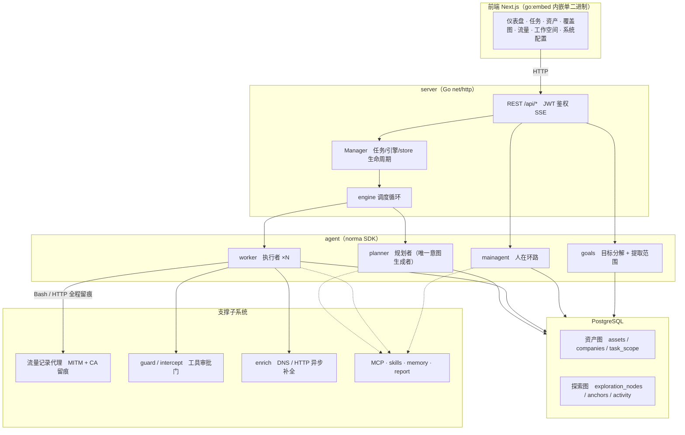
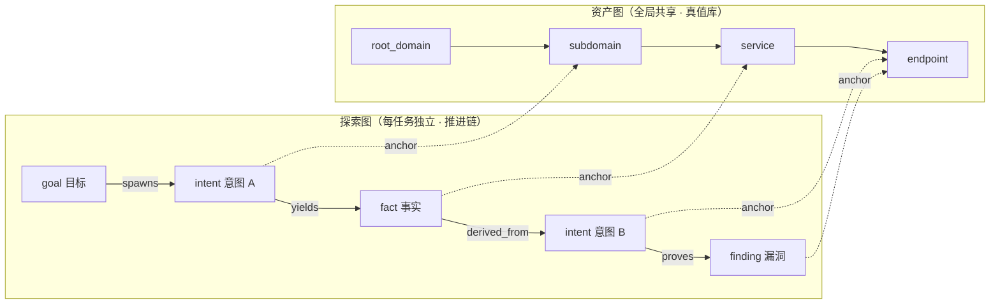
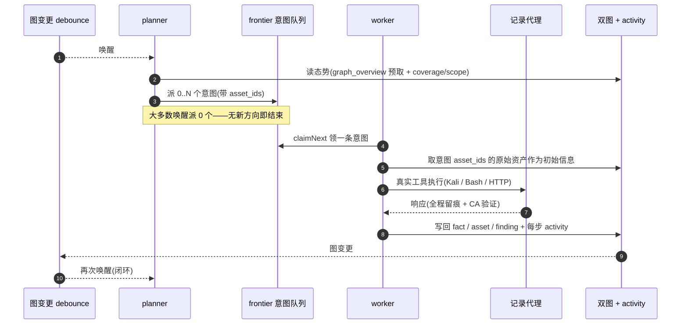
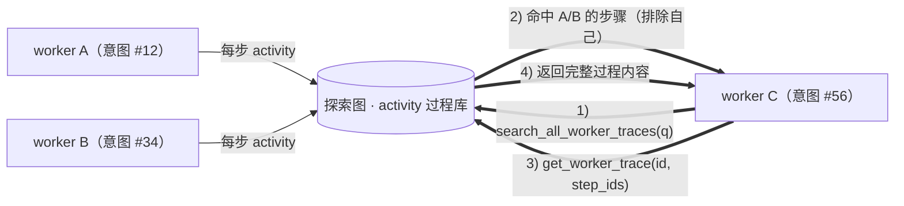
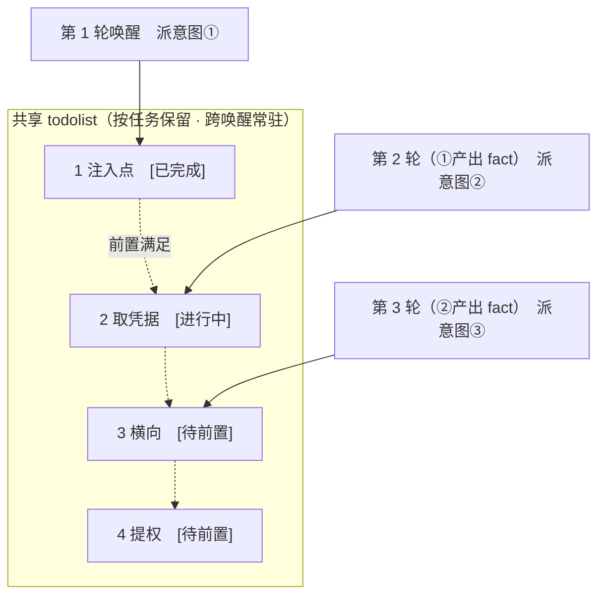

<div align="center">

# reArtex

AI 自主渗透测试系统（Go 后端 + Next.js 前端）· ARTEX 的安全加固分支

> **reArtex = ARTEX 的安全加固分支，独立发布线。** 本仓库在上游基础上修了一批 agent
> 越权与失效开放（fail-open）缺陷，核心是把安全约束从「可热改的 DB / settings」移到
> 「代码常量 + 编译期」。
>
> | | |
> |---|---|
> | **上游** | [wufufu770/ARTEX](https://github.com/wufufu770/ARTEX)（原作者仓库）—— reArtex **不向它推送任何改动** |
> | **本仓库的发布线** | 镜像 `ghcr.io/wufufu770/reartex`、二进制 [Releases](https://github.com/wufufu770/reArtex/releases) |
> | **更新策略** | 页面「一键更新」只跟随 **reArtex 自己的 Release**；上游的后续变更按需择取回合，**不自动同步** |
> | **安装** | 见 [安装](#安装)（Compose 拉镜像 / 下载预编译二进制 / 一键脚本 / 源码编译） |
> | **改了什么** | 见 [重点改了什么](#重点改了什么) 与 [与原版的区别](#这是什么--与原版-artex-的区别) |
> | **为什么改** | 见 [为了达到什么目的](#为了达到什么目的) |
> | **接下来** | 见 [未来打算改什么](#未来打算改什么) |

上游的在线 Demo（**非** reArtex 本体）：[artex-demo.vercel.app](https://artex-demo.vercel.app/)

</div>

---

## 这是什么 · 与原版 ARTEX 的区别

上游 ARTEX 是一套完整的 AI 自主渗透测试系统：Go 后端 + Next.js 前端，通过规则拦截、
模型判官审批、steer 纠偏等机制约束 agent 的工具调用。reArtex **不是重写**，而是**在它
之上做安全加固**的一支。

具体差别：

| 维度 | 原版 ARTEX | reArtex |
|---|---|---|
| **安全边界的载体** | 决定 agent 能做什么的表与设置项（`settings.intercept_enabled_tools`、`intercept_rules`）**本身可被持有 JWT 的人改** —— 一次 `PUT /api/settings` 或一条 `DELETE` 就能把整套防线整体关闭，且无留痕 | 关键约束写进 **Go 源码常量**，关闭途径只剩编译期开关 + 重启；DB 规则降级为「可调参数」而非「安全边界」 |
| **判官 / 审批失效时** | 判官超时、报错、输出不可解析 → 回落 `allow`（**fail-open**）；ask 类规则默认无超时，可无限等待 | 一律回落 `deny`（**fail-closed**）；ask 规则**强制**带超时（默认 60s，到点 deny） |
| **平台凭据** | `ARTEX_PG_DSN`、`ANTHROPIC_API_KEY` 等留在进程 exec 期环境块里，同 UID 的 agent 子进程可从 `/proc/<pid>/environ` 读走 | 控制面凭据读入即从进程环境抹除；DSN 可改走一次性文件（读入即清零删除）；启动自检给出「未残留/仍残留」结论 |
| **拦截动作的留痕** | 短路表的 deny 只落内存切片（上限 2000、进程退出即失） | 写入 `intercept_pending` 已决行（页面可查），并有 **digest 链**逐条串联、被篡改可定位到第几条 |
| **工具白名单故障** | `ListTools` 失败 → 打条日志 → 照常返回完整工具面（DB 一抖动，agent 立刻拿到全部工具） | 沿用上一份已验证快照；冷启动无快照时**拒绝创建新 run**（白名单未知时开工等于无边界放行） |
| **工程门禁** | 无测试 CI：发布 workflow 只编译，测试只能本地跑 | CI 门禁：编译 + vet + **全量测试（真实 Postgres，排除项为零）** + 前端构建 + **lint 棘轮门**；tag 发布前也必须过门 |
| **交付链** | 镜像与产物的来源指向原作者命名空间（fork 无权推），产物校验与"装进去的是不是刚编出来的那个"无人把关 | 交付源全部指向本仓库；镜像构建期**必填版本校验**（装错旧二进制会构建失败），发布后**冒烟**核对版本 |
| **更新源** | 上游 Release | **本仓库自己的 Release**（一键更新只跟随它） |

**没有改的**：agent 的执行模型、任务编排、探索引擎、前端交互骨架、资产同步
（ScopeSentry）与对外 API 形态。reArtex 改的是**边界与门禁**，不是功能面。

---

## 为了达到什么目的

先说清**为什么要动它**。原实现里，**决定 agent 能做什么的那几张表和设置项，本身可被持有 JWT 的人改** —— `settings.intercept_enabled_tools` 决定哪些工具进拦截器，`intercept_rules` 是规则本身。一次 `PUT /api/settings` 或一条 `DELETE` 就能把整套防线整体关闭，且无审计留痕。

于是加固落在三条目标上：

| 目标 | 手段 | 达成后的效果 |
|---|---|---|
| **① 边界不可被持有者自行放宽** | 关键约束从 DB / settings 移到 Go 源码常量；DB 规则只当参数 | 关掉防线只能改代码 + 重编译 —— 那是另一道门（能读仓库/能推镜像） |
| **② 任何「判定失效」都不得放行** | 判官超时/报错/输出不可解析 → 统一 `deny`；ask 强制超时；工具表读不到 → 拒绝开工 | 让判官、让 DB、让审批「失效」不再等于「放行」；故障方向从"开到关" |
| **③ 动作要留痕、边界要可验** | 判定写入已决行可查 + digest 链防篡改；平台凭据不落进程环境块；CI 门禁与交付链校验 | 出事后能定位到具体某一条；发布出去的东西能被证明是「刚编出来的」 |

所以加固的第一原则是：**安全边界不能挂在任何可热改的存储上**。本仓库所有新增约束都写进 Go 源码，关闭途径只剩编译期开关 + 重启。

---

## 重点改了什么

### 第一批 · 安全边界与失效开放

以下 9 项均已直读源码逐条验证属实（非推测），编号沿用《ARTEX限制强化方案-终版V2》。

| 编号 | 缺陷 | 原行为 | 现行为 |
|---|---|---|---|
| G-01① | 平台工具绕过白名单 | 改平台配置的工具若不在 `intercept_enabled_tools` 名单内，在 `IsToolEnabled` 处直接放行，规则根本轮不到求值 | 短路表插在 `applyIntercept` **最前面**，先于 `IsToolEnabled` |
| G-01③ | stdio MCP 无任何白名单 | 命令任意指定，等价于任意第三方代码执行；包名可抢注、无版本 pin 可供应链翻转 | 拒 17 个包执行器（`npx`/`uvx`/`bunx`/`pnpx`/`pipx`/`dlx`/`docker`/`podman`/`sh`/`bash`/`zsh`/`dash`/`python*`/`perl`/`ruby`/`node`），且命令须 PATH 解析成功 |
| G-02①-a | agent 可读平台自身凭据 | worker 的 Bash 与 server 同 UID，可读 `/app/jwt.key` 与 server 原始环境块（含 `ANTHROPIC_API_KEY`、`ARTEX_PG_DSN`） | 硬拦平台签名密钥、MITM CA 私钥与 `/proc/*/{environ,cmdline,mem}`；控制面凭据读入即从进程环境抹除；DSN 另可走 `ARTEX_PG_DSN_FILE`，读入即清零并删除文件，使进程环境块内不再有秘密 |
| G-03 | 拦截规则可被 JSON 转义绕过 | `Match` 只对原始入参字节做正则，`"r\u0065ad /app/jwt.key"` 匹配不上 `read` | 匹配前 JSON 深解码，raw 与 decoded 双形态都试 |
| G-04④ | 工具表故障时全量放行 | `ListTools` 失败 → 打条日志 → `return tools`，DB 一抖动所有 agent 立刻拿到完整工具面 | 沿用上一份已验证快照；冷启动无快照时降级为 SDK 基础件 8 件，**且直接拒绝创建新 run**（白名单未知时开工等于无边界放行） |
| G-07 | 工作区符号链接可越界 | `wsResolve` 只做词法 `Clean`，注释称"爬不出根"——但那对软链不成立；`saveUpload` 跟随符号链接 | `EvalSymlinks` 复核真实路径 + `O_NOFOLLOW` |
| G-09 | steer 消息无上限 | 纠偏消息直入 worker 上下文且不过闸，队列无界 | 限 2000 字符、队列 cap 10 |
| G-04①② | 模型兜底审批 fail-open | 判官超时、报错或输出不可解析时回落 `allow` —— 让判官失效即可绕过全部规则；ask 类规则默认无超时，审批可无限等待 | 失败/超时一律回落 `deny`；ask 规则强制带超时（默认 60s，到点 `deny`）；前端表单初值与后端默认对齐，避免保存一次就把 `allow` 写回 |
| G-17 | 拦截动作无留痕 | 短路表的 deny 只落内存切片（上限 2000、进程退出即失），且与 DB 规则/模型判定混作一谈 | 短路表 deny 写入 `intercept_pending` 已决行，「审批记录」页与任务拦截列表可查；来源标识区分 `rule` / `model` / `shortcircuit` |

### 第二批 · 凭据治理、审计链、门禁与交付链

| 编号 | 缺陷 | 原行为 | 现行为 |
|---|---|---|---|
| G-02①-a | 平台凭据残留在进程环境块 | `ARTEX_PG_DSN` 与平台 API key 留在 exec 期环境块，同 UID 的 agent 子进程可从 `/proc/<pid>/environ` 读走 | 控制面凭据读入即从进程环境抹除；DSN 另可走 `ARTEX_PG_DSN_FILE`（一次性文件，读入即清零删除）；启动自检读 `/proc/self/environ` 给出明确结论，`ARTEX_REQUIRE_ENV_SCRUB=1` 时残留即拒绝启动 |
| G-17′ | 已决判定无法防篡改 | 短路表 deny 只落内存切片（上限 2000、进程退出即失），与 DB 规则/模型判定混作一谈 | 判定写入 `intercept_pending` 已决行（页面可查），来源标识区分 `rule` / `model` / `shortcircuit`；另加 **digest 链**：每条把上一条的 digest 算进自己的 digest，`VerifyAuditChain` 能报出被改动的位置 |
| 类别五 | 无测试 CI | 发布 workflow 只编译五个平台，测试只能本地跑；仓库现有 lint 基线本身是红的，全量设为门等于永久失败 | `ci.yml`：编译 + vet + **全量测试（真实 Postgres，排除项为零）** + 前端构建 + **lint 棘轮门**（只查相对基线改动的文件）；tag 发布前也须过门 |
| — | 测试套件不可重复 | 各测试包共用一个库，前一个包留下的数据让后一个包的用例随机挂（基线上一次挂 10 个、一次挂 16 个，**测试名都不同**），门只能开成红的 | 每个测试包用**自己派生的库**（`internal/testdb`），互不可见；顺带测试不再往开发库灌数据。`llm_usage` 这类不在 `schema.sql` 里、由应用启动时单独建表的，也一并补上 |
| 类别六 | 交付源 404 / 产物无校验 | 镜像与产物指向原作者命名空间（fork 无权推）；「装进镜像的是不是刚编出来的那个」无人把关 | 交付源全部指向本仓库；镜像构建**必填** `--build-arg ARTEX_BINARY_VERSION`，构建时跑一次装进去的二进制核对版本（旧产物 → **构建失败**）；release 的 docker job **发布后冒烟**，把刚推上去的镜像拉回来真跑一次 |
| 类别四 | norma SDK 上游缺陷 | `go.mod` 锁 v0.4.3，原样传导三个缺陷（流解析丢 input usage、丢 Gemini thought_signature、长任务/大输出边角） | 升至 **v0.4.4**，上游已修并自带回归测试 |
| — | `graph_overview` 不展开公司范围 | 返回的 `coverage.scope` 只有任务自身范围 | 展开 `company_scope` 的 domain/ip/cidr/icp/keyword 规则与 `company_keywords`（取值用 `raw` 原文而非规范化列） |

### 第三批 · W-A 波次（分级审核、路径解析、凭据供给面、密钥加密）

这一批做的是把**已登记的活路径**逐条闭合或如实降级。功能面（执行模型、任务编排、探索引擎、对外 API）仍保持上游原样。

| 编号 | 缺陷 | 原行为 | 现行为 |
|---|---|---|---|
| G-01①′ | 平台工具一律要人工确认 | 7 件平台工具全部 ask —— 连「新建技能文件」这种日常操作也要打断 | **三档**：2 件 `deny`（MCP 注册）、4 件 `ask`（改可执行面 / 改既有行为 / 删证据库）、**1 件显式 allow**（新建技能）。显式 allow 是代码常量**主动判定放行**、仍插在判定最前 → 不重开「平台工具绕白名单」的原洞；allow 档判定也进审计链 |
| G-04①②′ | DB 规则的 ask 类可无限等待 | 种子规则照抄 `timeout_enabled=false` → 审批挂着不回来，人不在时该面永远卡住 | 命中 ask 的规则自动补 **60s 超时且超时即拒**（判官侧「不可用即拒」本就是默认值，第一批表里已成立） |
| G-09④⑥ | 审批无防疲劳机制 | 同一 agent 反复请求审批时，人只能一次次点 —— 疲劳点 allow 等于无限循环 | 计数维度 (agent, 工具, 时间窗)，**仅超阈值才**自动拒绝（默认 5 次 / 600 秒，可热改）；单次或少量请求**完全不受影响**；计数失败不升级（宁可多问一次人，不误拒正常任务） |
| G-02①-a′ | 入参路径只做字符串预筛 | `cat $(realpath ../../../jwt.key)` 这类经 shell 展开才现形的路径绕得过短路表 | 入参里的路径片段**按工具工作目录解析成真实路径**再判秘密清单（相对回溯 / 命令替换 / 软链 / 父目录软链都覆盖）；判定点仍在工具策略层（Stage 1 Deny，任何 permission mode 绕不过） |
| — | 工具层拒绝不留痕 | 工具层（Stage 1）早于 `PreToolUse` hook 求值 → hook 根本不跑 → 拿不到短路表那条留痕路径 | 由 server 注入的记录器把工具层拒绝写进审计链（顺带补上 Read/Write/Edit 面既有的老缺口） |
| — | 容器配置面暴露数据库口令 | `docker inspect` 能看到 environment 里的 DSN | 口令改由 **docker secret 文件**供给（`/run/secrets/pg_dsn`），配置面只剩文件路径；`/run/secrets` 进平台秘密清单 |
| — | 平台秘密只靠一次性自检 | 「进程环境块里没有秘密」是一次性结论，没有门守着 | 固化成**发布阻断门**（`verify-secret-env.sh` 进 release 冒烟，每次发布都验） |
| — | LLM key 明文存库 | 拿到数据库口令即可读出全部 LLM key | 改为 **AES-256-GCM 加密落库**（明文列置空），主密钥由文件供给（不进环境块、不进库；放数据目录内拒绝启动），历史明文行启动时自动迁移；AAD 绑定行名 → 改名触发重加密 |
| — | 运行时端到端验证缺失 | 单测覆盖了函数逻辑，但没在真实链路里验过 | 真实装配 → 判定 → 拒绝 → 审计链整条链有回归用例，并做过**反证**（撤掉判定后该用例确实变红） |

> **这一批新查实的两件事**（都写进了口径）：① 工具层（Stage 1）**早于** `PreToolUse` hook 求值 → 工具层的拒绝拿不到短路表那条留痕路径，故须另有留痕通道；② **`cap_drop: [SYS_PTRACE]` 是空操作** —— Docker 默认能力集本就不含它，而**同 UID 的 ptrace 并不需要该能力**，实测容器内读同 UID 进程的已映射内存依然成功。故「`/proc/<pid>/mem`」这条残留**仍然开放**（见下）。

### 改动清单

第一批（相对上游 `e6ec569`）：

```
a  guard/shortcircuit.go          +160   代码常量短路表（新文件）
a  guard/shortcircuit_test.go     +102
a  intercept/normalize_test.go    +51
a  server/nofollow_unix.go        +10    O_NOFOLLOW 常量
a  server/nofollow_windows.go     +7
m  intercept/intercept.go         +57/-7
m  server/mcpdiscover.go          +43/-3
m  server/assembly.go             +36/-2
m  server/workspace.go            +32/-1
m  guard/guard.go                 +16
m  server/engine.go               +10
m  docker-compose.yml             +1     env 开关透传
```

第二批（相对 `1b29664`）：30 files changed, 1899 insertions(+), 34 deletions(-)

```
a  pathguard/pathguard.go         +136/-0   真实路径解析 + 控制面秘密拒绝列表（新文件）
a  pathguard/pathguard_test.go    +153/-0
a  netguard/netguard.go           +166/-0   拨号期出网目的地守卫（新文件）
a  netguard/netguard_test.go      +153/-0
a  agent/toolpolicy.go            +42/-0    工具执行前的平台侧安全策略（新文件）
a  agent/toolpolicy_test.go       +110/-0
a  server/skill_trust.go          +108/-0   skill 信任分档（新文件）
a  server/skill_trust_test.go     +129/-0
a  server/skill_demote.go         +108/-0   agent 写入的 skill 正文降权注入（新文件）
a  server/skill_demote_test.go    +108/-0
a  config/config_test.go          +102/-0
a  agent/provider_env_test.go     +41/-0
a  db/pgdsn_env_test.go           +40/-0
a  server/customtool_env_test.go  +39/-0
a  server/platform_tools_test.go  +47/-0
a  mcphttp/client_sse_test.go     +42/-0
m  config/config.go               +100/-2   ARTEX_PG_DSN_FILE 来源 + 启动自检
m  db/db.go                       +23/-1    DSN 读入即从进程环境抹除
m  agent/provider.go              +33/-2    API key 读入即抹除
m  agent/assembly.go              +5/-3     策略装饰器包裹全量工具
m  server/customtool.go           +44/-2    自定义脚本改白名单继承宿主环境
m  server/platform_tools.go       +49/-0    MCP 定义写库侧校验
m  mcphttp/client.go              +29/-7    MCP SSE 端点同源校验
m  guard/shortcircuit.go          +32/-12   environ 规则覆盖 glob 与展开形态
m  server/skill_usage.go          +9/-3     skill 计量接入信任档
m  server/server_mgmt.go          +6/-0     skill 写操作同步信任档
m  server/server.go               +14/-0    启动自检调用点
m  server/assembly.go             +1/-1     计量链路传入 skill 目录
```

第三批（W-A 波次）：31 files changed, 1553 insertions(+), 38 deletions(-)

```
a  pathguard/tokens.go             +145/-0   入参路径片段提取与解析（新文件）
a  pathguard/tokens_test.go        +123/-0
a  config/masterkey.go             +77/-0    主密钥加载与位置校验（新文件）
a  config/masterkey_test.go        +91/-0
a  db/crypto.go                    +77/-0    AES-256-GCM 加解密，AAD 绑定行名（新文件）
a  db/crypto_test.go               +85/-0
a  db/llmkey_migration.go          +54/-0    历史明文 key 迁移（新文件）
a  db/llmkey_test.go               +166/-0
a  server/toolpolicy_e2e_test.go   +71/-0    端到端回归：装配→拒绝→审计链（新文件）
a  verify-secret-env.sh            +45/-0    环境块洁净性发布门（新文件）
a  verify-ptrace-blocked.sh        +42/-0    ptrace 封闭诊断（该条未闭合，供自查）（新文件）
a  init-pg-dsn-secret.sh           +35/-0    由 .env 生成 secret 文件（新文件）
m  db/config.go                    +123/-22  profile 读写密文化 + 改名重加密
m  config/config.go                +39/-2    只读 secret 供给容忍 + 错误信息如实化
m  agent/toolpolicy_test.go        +95/-0
m  agent/toolpolicy.go             +18/-0    接入入参路径判定 + 拒绝留痕
m  agent/assembly.go               +11/-0    工具层留痕注入缝
m  server/assembly.go              +16/-0    留痕接线（audit 链写入）
m  server/manager.go               +14/-0    主密钥位置校验 + 迁移调用
m  docker-compose.yml              +18/-1    secret 供给 + cap_drop
m  .github/workflows/release.yml   +16/-1    冒烟改 secret 供给 + 环境块洁净性门
m  Dockerfile                      +6/-1     两个验收脚本进镜像
m  guard/shortcircuit_test.go      +14/-0    三档断言
m  pathguard/pathguard_test.go     +9/-0     /run/secrets 秘密清单断言
m  db/schema.sql                   +3/-0     api_key_cipher 列
m  .gitignore                      +3/-0     secrets/
m  guard/shortcircuit.go           +2/-0     allow 档
m  pathguard/pathguard.go          +1/-0     /run/secrets 进秘密清单
```

**平台工具的三档归属**（第三批调整后）：`create_mcp` / `update_mcp` = **硬拦**（凭据汇，无人工放行路径）；`create_custom_tool` / `update_custom_tool` / `update_skill_file` / `delete_assets_by_host` = **转人工审批**（60 秒不确认即拒绝）；`create_skill` = **代码级显式放行**（新建技能不覆盖既有行为，日常操作不再被打断）。相对第二批的变化：建 MCP 仍是硬拦，但**建技能从「人工审批」放宽为「显式放行」** —— 这是**有意的行为变更**（用覆盖面换日常可用性），且「显式放行」仍是代码常量在判定最前主动求值，不是漏判。

### 审计过程中额外发现并修掉的三个问题

1. **MITM CA 私钥未受保护**：原注释声称覆盖 `*.pem`，正则里根本没有；而容器里确实存在 `/app/data/traffic/_ca/mitmproxy-ca.pem`（MITM CA 私钥）。已补进拦截表。
2. **规则过宽误伤渗透正常工作**：初版按目录前缀一刀切（`/app/data/**/*.key`、裸 `/\.env\b`）。但 agent 工作目录正是 `/app/data/sessions/<key>`，工作区就落在 data 目录里——**目标的 `.env` / `.key` / `jwt.key` 全被误拦**，而 `.env` 恰恰是渗透最常要读的东西。已改为按具体凭据文件列举。
3. **应急开关是假的**：注释写着 `ARTEX_DISABLE_SHORT_CIRCUIT=1` 可停用短路表，代码里从没读过这个环境变量。已实现（`init()` 读取，启动日志留痕），并把开关内核抽成可测函数。

### 已知残留（未做）

- **平台环境块规则是字符串预筛。** 运行时才成形的路径（`find /proc -name environ -exec cat {} \;`）仍能绕过。闭合靠的是供给侧 —— 凭据根本不进进程环境块，见下一节。
- **`/proc/<pid>/mem` 读同 UID 进程的内存仍可做到**（实测在容器里能读）。这里有个容易想错的点：**同 UID 的 ptrace 不需要 `CAP_SYS_PTRACE`**，所以 `cap_drop: [SYS_PTRACE]`（Docker 默认能力集本就不含它）**挡不住这条**。真正的闭合要让工具进程与 artex **不同 UID**（属 per-task 隔离那一档），或让内存里不留明文秘密。镜像里留了 `verify-ptrace-blocked.sh` 供运维自查（它**故意不进发布门**，因为这条尚未闭合）。
- **平台环境块规则作用在整个工具入参 JSON 上**，故「把含 `/proc/…/environ` 字样的内容写进文件」也会被拦。
- **产物无独立签名**：Release 的 `SHA256SUMS` 与二进制同源（同一个 Release），能篡改 Release 的人可以同时替换两者。当前信任模型是「信任 GitHub Release」。
- **lint 棘轮门是「按文件」判定的**：碰到带着既有 lint 债的文件会让门变红（触碰过的文件已清干净）。这不是 bug 而是该门的语义 —— **碰了脏文件就得顺手清干净**。

本批已闭合（原先也登记在上面，现已消解）：

- ~~短路表是入参字符串预筛~~ → 入参里的路径片段现在**按工具工作目录解析成真实路径**再判定（`pathguard.CheckInputPaths`），`cat $(realpath ../../../jwt.key)` 这类经 shell 展开才现形的路径已被拒；判定点仍在工具策略层（Stage 1 Deny，任何 permission mode 绕不过）。**剩余边界**：运行时才成形的路径（编码/拼接/下载内容决定）仍在射程外，容器内 root 的读取也不在本层覆盖内。
- ~~`docker inspect` 仍可见容器配置里的 DSN~~ → 口令改由 **docker secret 文件**供给，`docker inspect` 的 Env 里只有文件路径。
- ~~`llm_profiles.api_key` 明文存库~~ → 改为 **AES-256-GCM 加密落库**，主密钥由文件供给（不进环境块、不进库），历史明文行在启动时自动迁移。详见[加密落库的 LLM key](#加密落库的-llm-key)。
- ~~G-09 ask 队列治理未做~~ → 已做：计数维度 (agent, 工具, 时间窗)，**只在同一 agent 反复请求同一高危面超阈值时**才自动拒绝（默认 5 次 / 600 秒，可热改）；单次或少量请求完全不受影响。
- ~~尚未做运行时端到端验证~~ → 已做：真实装配（`AugmentTools`）→ 工具层判定 → 拒绝 → 审计链留痕整条链有回归用例，并做过反证（撤掉判定后用例确实变红）。

### 应急回滚

短路表整体停用（重启生效，无需重新构建镜像）：

```bash
# docker-compose.yml 里设，或临时注入
ARTEX_DISABLE_SHORT_CIRCUIT=1 docker compose up -d
```

启动日志出现 `[guard] ⚠ 短路表已停用` 即生效。接受 `1/true/yes/on`。停用后平台退化为「仅 DB 规则」防线——而 DB 规则本身可被持 JWT 者热改。

### 平台凭据不出现在进程环境块

`ARTEX_PG_DSN` 经容器环境变量下发时，会留在进程的 exec 期环境块里，而 `/proc/<pid>/environ` 对同 UID 的 agent 子进程可读；更要紧的是它**还留在容器的配置面**（`docker inspect` 能看到）。

**推荐形态（v0.4.1+）**：口令走 **docker secret 文件**，容器配置面里根本没有口令：

```bash
./init-pg-dsn-secret.sh   # 由 .env 生成 secrets/pg_dsn（0600，不进版本库）
docker compose up -d
```

secret 以只读方式挂到 `/run/secrets/pg_dsn`，`/run/secrets` 已在平台的秘密清单里
（agent 读不到）。**只读挂载的文件删不掉也清不掉**，所以这条路径不适用「读入即销毁」；
它靠的是「不在 environment 里、不在 agent 工作区内」这两点。

若不使用 compose（比如裸跑二进制），可用 `ARTEX_PG_DSN_FILE` 指向一次性文件：

````yaml
services:
  artex:
    entrypoint:
      - /bin/sh
      - -c
      - >-
        umask 077; mkdir -p /run/artex;
        printf '%s' "$$ARTEX_PG_DSN" > /run/artex/pg_dsn;
        unset ARTEX_PG_DSN;
        exec /app/start.sh "$$@"
      - --
    # 必须显式写出：覆盖 entrypoint 后 compose 不再带镜像的 CMD，
    # 而 wrapper 的 "$@" 就空了 —— 结果只剩默认的 :8787，录制代理 :8788 不会起。
    command: ["-addr", ":8787", "-proxy", ":8788"]
    environment:
      ARTEX_PG_DSN_FILE: /run/artex/pg_dsn
````

三点说明：

- **`unset` 必须在 `exec` 之前。** `unset` 只改 shell 内部变量表，改不动内核保存的 exec 期环境块；而 `exec` 会用当前环境**重建**进程映像，所以 exec 出来的进程环境块里才没有 DSN。顺序反了无效。
- **进程启动后会读入该文件并立即清零、删除它**，磁盘上不留副本。
- **`command` 不能省。** 覆盖 `entrypoint` 后 compose 不再带镜像的 `CMD`，wrapper 的 `"$@"` 会是空的。

启动时平台会自检 `/proc/self/environ` 是否仍残留平台凭据并给出结论（`[security] 平台凭据未残留在进程环境块中`）。若希望残留时直接拒绝启动，设 `ARTEX_REQUIRE_ENV_SCRUB=1`。

---

## 加密落库的 LLM key

`llm_profiles.api_key` 可以用主密钥加密后落库（拿到数据库口令的人，没有主密钥就读不出 key）。**默认不启用** —— 不配主密钥时行为与从前完全一致（明文落库），只是没有这层保护。

启用方式：

1. 生成主密钥，放到**数据目录之外**（数据目录是 agent 的工作区根，放进去等于没加密）：

   ```bash
   mkdir -p /run/artex
   openssl rand -hex 32 > /run/artex/master.key
   chmod 600 /run/artex/master.key
   ```

2. 在 compose 的 `artex.environment` 里加一行（**只放路径，不放密钥本身**）：

   ```yaml
   ARTEX_MASTER_KEY_FILE: /run/artex/master.key
   ```

3. 重启后，历史明文行会在启动时自动迁移成密文（日志里会打印迁移了几行）。

四点说明：

- **主密钥文件放错位置会被拒绝启动**（在数据目录内即报错），因为那等于把钥匙挂在 agent 够得着的地方。
- **丢了主密钥 = 所有已加密的 LLM key 都解不开**（只能重新填）。请备份该文件。
- 密文的 **AAD 绑定行名**：不同 profile 的密文不能互换（有库写权限的人不能把 A 行的 key 挪到 B 行再配上自己可控的 `base_url` 把 key 送出去）。因此**改名会触发重加密**。
- 平台**不会**把主密钥写进环境块或数据库，只留在进程内存里。

---

## 未来打算改什么

按「还欠着什么」排，不承诺时间。每项都对应上文或[已知残留](#已知残留未做)里登记的东西。

| 计划 | 目的 | 现状 |
|---|---|---|
| **运行时权限边界**（可信授权 + 统一入口 + 任务隔离 + 强制网络出口） | 现在的硬边界主要靠**代码常量**与**凭据不落环境块**；真正的"每个任务一个受限身份、出网只走允许的通道"还没建。计划形态：per-task runner + 最小 env/netns + 默认拒绝直连 | **进行中**：执行层收口已落地（入参路径按工作目录解析并留痕、口令走 secret 文件不进配置面、平台工具分级审核），但 per-task 隔离与净网未做 —— 工作量最大的一项 |
| **产物签名与来源证明** | Release 的 `SHA256SUMS` 与二进制同源，能改 Release 就能同时换掉两者。计划：产物签名（cosign / minisign）+ SBOM + 校验 buildx provenance | 规划中 |
| **测试隔离下沉到用例级** | 现在是**每包一个独立库**，包内用例仍共享一个库（顺序敏感）。计划：按用例隔离或补统一的清理钩子，让用例可任意顺序、可并行 | 规划中 |
| **发布后冒烟扩到多架构 + 不可变标签** | 现在冒烟只验 amd64；Compose 默认用 `latest` 这个可变标签。计划：冒烟覆盖 arm64、Compose 默认改用不可变 tag 或 digest | **部分**：发布冒烟已加**环境块洁净性**阻断门（每次发布都验），arm64 冒烟与不可变标签未做 |
| **上游择取回合的可重复流程** | reArtex **不自动同步**上游（更新只跟自己的 Release），但上游后续仍有变更。计划：把"评估一个上游提交要不要回合"做成有据可依的固定流程，而不是临时手工挑 | 规划中 |
| **生态补齐**（skills 同步 / 更新即重启 / 回滚数据 / 复测导出） | 上游登记的部署与生态类问题：多端 skill 同步、页面更新后的容器换装、数据回滚、复测结果导出 | 规划中 |

一个刻意的选择：**这一批只做边界与门禁，不动功能面**。agent 的执行模型、任务编排、探索引擎与对外 API 形态都保持上游原样 —— 加固应当让系统更可被信任，而不是更难用。

---

> 完整交互见[在线 Demo](https://artex-demo.vercel.app/)。

| 仪表盘（总览 / Token 消耗 / 活动流） | 任务列表 |
| :---: | :---: |
|  |  |

| 任务 · 执行过程（会话 / 工具调用） | 探索链路 |
| :---: | :---: |
|  |  |

| 发现 | 资产 |
| :---: | :---: |
|  |  |

| 资产覆盖图（力导向布局 · 已测高亮 · 节点折叠展开） |
| :---: |
|  |

| 流量录制 | 人在环路对话 |
| :---: | :---: |
|  |  |

| Agent 管理 | LLM 配置 |
| :---: | :---: |
|  |  |

| 拦截审批 | 后端日志 |
| :---: | :---: |
|  |  |


---

## 审批记录详情

全局「审批记录」、任务内「拦截审批」及对话中的审批卡片均支持展开查看详情。展示结构参考
[AegisHook 的审批详情组件](https://github.com/RuoJi6/AegisHook/blob/main/web/src/components/CallDetail.vue)，沿用 ARTEX 的组件和主题：


## 资产同步（ScopeSentry）

支持从 [ScopeSentry](https://github.com/Autumn-27/ScopeSentry) 直接同步资产数据，免去重复收集：

- 在「**资产同步**」页填 ScopeSentry 的地址与 API Key，接入数据源；
- 按**项目**或**任务**维度选择要同步的目标与资产类型（域名 / 子域 / IP / 端口 / 站点 / 端点…）；
- 一键导入并按公司资产范围归并，直接进入 ARTEX 的资产图供 agent 探索使用。

---

## 安装

> 依赖数据库 **PostgreSQL**；探索需配置 **LLM**（`ANTHROPIC_API_KEY` 或 `OPENAI_API_KEY`，也可在 UI 里配）。
>
> 下面所有产物都来自 **reArtex 自己的发布线**（`ghcr.io/wufufu770/reartex` 与本仓库的
> Releases），不跟上游 ARTEX 的发布。

### 方式一：Docker Compose（推荐）

```bash
git clone https://github.com/wufufu770/reArtex.git
cd reArtex
cp .env.example .env          # 填 POSTGRES_PASSWORD、可选 ANTHROPIC_API_KEY
./init-pg-dsn-secret.sh       # 由 .env 生成数据库连接串 secret（0600，不进版本库）
docker compose up -d          # 拉取 ghcr.io/wufufu770/reartex 镜像 + postgres
# → http://localhost:8787
```

镜像已含常用工具（ripgrep/curl/vim/npm/nmap…）；`./skills` 与 `./data` 以绑定挂载持久化。

> **`init-pg-dsn-secret.sh` 不能省**：数据库口令走 **docker secret 文件**供给
> （`/run/secrets/pg_dsn`），这样 `docker inspect` 看不到口令 —— 口令留在容器的
> `environment` 里就等于把它摊开给任何能看容器配置的人。该脚本从 `.env` 拼出连接串
> 写进 `secrets/pg_dsn`（权限 0600，`secrets/` 已被 .gitignore 排除）。
> 该形态需要 **v0.4.1 及以后**的镜像（更早的镜像不认只读 secret 挂载）。

指定版本：`.env` 里设 `ARTEX_TAG=v0.4.1`（不设则用 `latest`）。**建议固定版本**，不要用
可变的 `latest` —— 出了问题没法确定跑的是哪一版。

> **想要拉取的那个 tag 还没发布时**：本仓库的 Release 随 `v*` tag 生成，ghcr 镜像与之同批
> 推送。若你要的版本尚未发布，镜像就还不存在，上面那条 `docker compose up -d` 会拉取失败。
> 两条走法：
>
> - **等发布**：打 tag 时 release workflow 会自动构建多架构镜像推上 ghcr.io，并生成带
>   `SHA256SUMS` 的 GitHub Release；届时上面的命令直接可用。
> - **先本地构建**（需要 Go ≥ 1.26、Node ≥ 20、rsync、zip）：
>   ```bash
>   ./build-image.sh                                  # 编前端 + 编二进制 + 构建镜像 artex:local
>   echo "image: artex:local" > docker-compose.override.yml
>   docker compose up -d
>   ```
>
>   `build-image.sh` 会在构建期核对镜像里的二进制版本与本次构建是否一致，
>   装错旧二进制会直接构建失败，不会让你拿到一个"看着新、其实是旧"的镜像。

远程 MCP 可在系统设置中选择 `http`（Streamable HTTP）或 `sse`（旧版 SSE）。
旧版 SSE 服务通常使用 `GET /sse` 建立事件流，再通过服务返回的
`/message?sessionId=...` 接收 JSON-RPC 请求；配置时将 URL 填为 `/sse`，请求头按
`Authorization=Bearer <token>` 填写。

### 方式二：下载预编译二进制（reArtex Releases）

到 [Releases](https://github.com/wufufu770/reArtex/releases) 下载对应平台的 zip，解压后得到 `artex` + `start.sh`（Windows 为 `start.bat`）+ `skills/` + `config.example.json`：

```bash
cp config.example.json config.json   # 填好 database 连接
./start.sh                           # → http://localhost:8787
```

> 请用 `start.sh` / `start.bat` 启动，而不是直接跑 `./artex`。它是个守护脚本：程序退出后按退出码决定是否重新拉起，**页面上的[一键更新](#方式一页面一键更新推荐)靠它完成换装**。直接运行 `./artex` 时更新完就不会被拉起了。
> 后台常驻：`nohup ./start.sh >artex.log 2>&1 &`。

### 方式三：一键安装脚本

```bash
git clone https://github.com/wufufu770/reArtex.git
cd reArtex
./install.sh
```

脚本会：检测 / 自动安装 Docker → 让你选 **① 全部 Docker** 或 **② 本地编译运行**：

- **① 全部 Docker**：填一个 Postgres 密码（可回车随机）→ 自动写 `.env` → `docker compose up -d`。
- **② 本地运行**：选数据库（连已有 / 用 Docker 起一个）→ 生成 `config.json` → `go` 编译内嵌单二进制 → 启动。

装好后打开 **http://localhost:8787**（首次进入 `/setup` 设置管理员密码）。

### 方式四：从源码编译单二进制

```bash
# 1) 前端静态导出
cd web && npm ci && npm run build:static && cd ..
# 2) 拷进内嵌目录
cp -r web/out server/webui/dist
# 3) 编译（-tags embedui 才内嵌前端）
CGO_ENABLED=0 go build -tags embedui -o artex ./cmd/artex
./start.sh
```

### 方式五：构建跨平台 Release 压缩包

`build.sh` 会先构建并嵌入前端，再使用 Go linker 去除调试信息，并将发布文件压缩为 zip。Release 模式默认生成 Linux amd64/arm64、macOS amd64/arm64 和 Windows amd64 的 zip 包：

```bash
./build.sh --release
# 产物：dist/artex-0.4.0-*.zip
```

UPX 自解压二进制可能与部分 Linux 内核、虚拟化环境或安全策略不兼容，因此默认不启用。可用 `ARTEX_TARGETS` 自定义目标；确认目标运行环境兼容时，可显式传入 `--upx` 进一步缩小二进制：

```bash
ARTEX_TARGETS=linux/amd64,windows/amd64 ./build.sh --release
./build.sh --target linux/amd64 --upx
```

---

## 更新升级

> **更新源只有本仓库自己的 Release**（`wufufu770/reArtex`）—— 不跟上游 ARTEX 的发布线。
> 拉到的包会先比对同批 Release 的 `SHA256SUMS`，再冒烟测试、换装；失败自动回滚。
>
> 升级只换程序、不动数据：Postgres 数据卷 `pgdata`、`./data`（jwt.key / SQLite 等）、`./skills` 都会保留。**数据库迁移无需手动执行**——`artex` 每次启动会幂等重跑 `schema.sql`（含 `ADD COLUMN` / `CREATE INDEX IF NOT EXISTS`），即“重启即迁移”。升级前仍建议先备份 `./data` 与数据库。

### 方式一：页面一键更新（推荐）

在 **系统配置** 页（侧边栏「系统配置」→ `/system/settings`）的**版本与更新**卡片里，可以直接检查并安装新版本，无需登录服务器。

点「更新」后：下载当前平台的发布包 → 比对 Release 的 `SHA256SUMS` → 用 `-h` 冒烟测试新二进制 → 暂存为 `artex.new` → 程序退出，由 `start.sh` / `start.bat` 重新拉起并完成换装。页面会自动等到新版本上线后刷新。

- **失败不会留下坏程序**：校验或冒烟不通过就丢弃暂存件、继续跑当前版本；换装后的新版若连续 3 次启动失败，会自动回滚到 `artex.old`（失败的那个留作 `artex.failed` 供排查）。
- **随时可回退**：上一版本保留为 `artex.old`，卡片上有「回滚到上一版本」。注意数据库结构不会回退。
- **更新会中断正在运行的任务**——更新即重启，请在空闲时进行。
- **开发构建不给更新**：版本号是 `dev` 或 `git describe` 带后缀时禁用，避免正式版覆盖掉本地调试的二进制。
- **Docker 下只换程序、不换镜像**：镜像里的 playwright / nmap 等工具链不会跟着升级，且 `docker compose up -d` 重建容器后会退回镜像自带的版本。要连镜像一起升级仍请用 `docker compose pull artex && docker compose up -d artex`。
- 访问 GitHub 需要代理时，在同一页面配置**全局代理**即可，更新链路会走它。更新只从 GitHub 域名下载并强制 HTTPS。

### 方式二：一键更新脚本

```bash
cd reArtex
./update.sh
```

脚本先可选 `git pull` 拉取最新代码，再让你选 **① Docker 更新** 或 **② 本地编译更新**（与 `install.sh` 对应）：

- **① Docker**：可指定目标镜像 tag（回车沿用 `.env` 的 `ARTEX_TAG`，缺省 `latest`）→ `docker compose pull` → `docker compose up -d`（换新镜像重启即自动迁移）。
- **② 本地**：重建前端静态产物 → 重新编译 `./artex`（完成后重启进程生效）。

### 方式三：Docker Compose（手动）

```bash
cd reArtex
git pull                       # 更新 compose / 脚本（可选）
# 指定版本：在 .env 设 ARTEX_TAG=v0.2.0；不设则用 latest
docker compose pull artex
docker compose up -d artex     # 换新镜像重启 → 自动迁移 schema
docker image prune -f          # 清理旧镜像（可选）
```

### 方式四：预编译二进制（Releases）

到 [Releases](https://github.com/wufufu770/reArtex/releases) 下载新版本 zip，停掉旧进程后覆盖 `artex` 与 `skills/`（保留你的 `config.json` 与 `data/`），重启即可：

```bash
cp -r <解压目录>/skills ./ && cp <解压目录>/artex ./
./start.sh
```

### 方式五：从源码编译

```bash
git pull
cd web && npm ci && npm run build:static && cd ..
cp -r web/out server/webui/dist
CGO_ENABLED=0 go build -tags embedui -o artex ./cmd/artex
# 重启 ./start.sh
```

---

## 配置

**数据库**（`config.json`，或用环境变量 `ARTEX_PG_DSN` 覆盖）：

```json
{
  "database": {
    "host": "127.0.0.1", "port": 5432,
    "user": "artex", "password": "yourpass",
    "dbname": "artex", "sslmode": "disable"
  }
}
```

**LLM**：`export ANTHROPIC_API_KEY=sk-...`（或 `OPENAI_API_KEY`），也可在 UI 的「LLM 配置」页填写。
可选：`ARTEX_LLM_PROVIDER` / `ARTEX_LLM_MODEL` / `ARTEX_LLM_BASE_URL` / `ARTEX_LLM_PROXY`。

**并发**：每个任务的 work agent 数在「系统设置」里配置（默认 3）。

**常用参数**：`./start.sh -addr :8787 -proxy :8788`（`-addr` 前端+API，`-proxy` 流量录制代理）。启动脚本会把参数原样透传给 `artex`。

### 反向代理部署（HTTPS / 只开放 443）

前端和 API/SSE 都由同一个后端端口（默认 `:8787`）提供，实时活动流默认走**同源**地址，因此**无需配置 `NEXT_PUBLIC_SSE_BASE`**，公网只开放 443、把 8787 留在内网即可。

SSE 是长连接 + 持续推送，反代**必须关闭缓冲**，否则浏览器能连上却收不到事件（表现为活动流一直转圈）。Nginx 示例：

```nginx
server {
    listen 443 ssl;
    server_name your.domain.com;
    # ssl_certificate / ssl_certificate_key ...

    location / {
        proxy_pass http://127.0.0.1:8787;
        proxy_set_header Host $host;
        proxy_set_header X-Forwarded-Proto $scheme;

        # SSE 关键项：关缓冲、长超时、HTTP/1.1
        proxy_buffering off;
        proxy_cache off;
        proxy_read_timeout 3600s;
        proxy_http_version 1.1;
        proxy_set_header Connection "";
    }
}
```

> 仅当 SSE 需要走与页面不同的来源（如独立子域）时，才在**构建期**设置 `NEXT_PUBLIC_SSE_BASE`（该变量在 `next build` 时固化进静态包，容器运行时再设无效）。

---


## 开发

### 手动漏洞复测

任务详情的「复测」页签可分页选择本任务的漏洞、查看历次结论和证据，并手动发起复测。启动后保留当前页签，显示转圈图标和「复测中」；确认修复后同步更新漏洞状态。

在漏洞列表每行操作区点击「复测」，或在漏洞详情的「漏洞复测」区域点击「发起复测」，填写可选的修复版本、测试条件或限制，系统会创建独立的复测 Agent 会话，启动后保留当前页面。列表的平铺、按任务分组和资产视图均支持该入口；复测运行时显示转圈图标和「复测中」，需要查看时点击进入对应会话，结束后恢复「复测」。复测无需重新启动原扫描任务，结论分为「仍可复现」「已修复」「无法确认」，每次的结论、证据和会话链接保存在漏洞详情中。

新版后端首次启动会预置可编辑的「漏洞复测」（`retester`）Agent，可在 Agent 管理中配置提示词、LLM、运行预算和工具。默认使用其绑定的 LLM，未绑定则使用全局激活配置。复测会话成功完成且结论为「已修复」时，系统自动将漏洞处置状态改为「已修复」；执行中、失败、停止或其他结论保留原状态。原始证据和报告始终保留。也可在状态下拉菜单中手动选择「已修复」。同一漏洞正在复测时复用已有会话，停止、失败或服务重启后可重新发起。

本版历史记录通过漏洞详情和会话查看，暂未纳入漏洞报告导出或任务归档包，也未自动关联流量包。演示模式只生成明确标注的模拟记录，不请求真实目标。

### 本地运行与测试

```bash
./dev.sh    # 后端(:8787) + 流量代理(:8788) + 前端 next dev(:5173) → http://localhost:5173
```

- 后端：`go run ./cmd/artex`（不带 `-tags embedui` 则不内嵌前端）
- 前端：`cd web && npm run dev`（`/api` 反代到后端，带热更新）
- 测试：`go test ./...`
- Mock 预览（无后端）：`cd web && NEXT_PUBLIC_MOCK=1 npm run dev`

---

## 系统技术架构

ARTEX 是一套 **LLM 多 agent 驱动的自主渗透系统**：Go 单体后端（内嵌 Next.js 前端）+ PostgreSQL，agent 能力由 [`norma`](https://github.com/Autumn-27/norma) SDK 提供（`agentcore` / `tool` / `permission` / `harness` / `memory` / `transcript`）。核心是**双图架构**，以及围绕它的两条自主性机制：**worker 间过程级信息交换**与 **planner 多轮共享 todolist 稳定攻击链路**。

### 总体分层



| 层 | 职责 |
| --- | --- |
| **前端** | Next.js 静态导出，`go:embed` 内嵌进单二进制；可视化任务/资产/探索链路/覆盖图，人在环路对话 |
| **server** | `net/http` 路由 + JWT 鉴权 + SSE；`Manager` 托管任务、引擎、DB store 的生命周期 |
| **engine** | 每任务一个 `plannerLoop` + N 个 worker goroutine；意图领取、超时/暂停/drain |
| **agent** | goals / planner / worker / mainagent，`ToolSet` 把双图暴露成 LLM 工具 |
| **db** | 双图的 Postgres 落地（pgx）；schema 随 `go:embed` 每次启动幂等建表 |
| **支撑** | 记录型 MITM 代理、审批门、异步补全、MCP/技能/记忆/报告 |

### 双图架构：探索图 + 资产图

系统把「**目标是什么**」和「**测到了什么程度**」拆成两张相互独立、又通过锚点相连的图：

- **资产图（Asset Graph，全局共享）**：跨任务同一份的资产真值库。节点为 `root_domain / subdomain / ip / service / app / endpoint`，归属公司；域名→子域→服务→端点的父子关系与去重 key 全部由程序计算，agent 只提交原始信息。
- **探索图（Exploration Graph，每任务独立）**：一次任务的“思考与推进”过程。节点为 `goal（目标）/ intent（意图）/ fact（事实）/ finding（漏洞）/ hint（提示）`，靠 `spawns / derived_from / yields / proves` 等边连成**血缘链**，回答“哪个方向派生自哪些事实、产出了什么”。
- **两图靠锚点相连**：`exploration_anchors(node_id, asset_id)` 把意图/事实/漏洞锚定到具体资产上——于是既能从“探索方向”看它打的是哪些资产，也能从“某个资产”反查它在本任务被哪些意图测过、得出过哪些事实。这也支撑了**资产测试覆盖度**与**资产覆盖图**（范围内资产 + 已测高亮）。



> 分工：**planner** 读探索图态势、判目标、只在有未覆盖的新方向时派**意图**进 frontier；**worker** 领**一条意图**、用真实工具执行、把新资产/事实/漏洞写回两图后即停。资产图是共享事实，探索图是每任务的推进链。

### 引擎与意图生命周期（一次探索的闭环）

引擎是**事件驱动**的闭环：图一变就唤醒 planner，planner 派意图，worker 领意图执行并写回，写回又触发下一轮——直到目标被证明（`prove_goal`）。



### worker 间的过程级信息交换

一次深入的探索里，很多有价值的观察（某个报错、某段响应、某个隐藏参数）出现在一个 worker 的**执行过程**中，却未必被写成正式 fact。为避免重复劳动、让链路上的 worker 能站在彼此的肩膀上，worker 具备**跨 work 检索过程**的能力：

- `search_all_worker_traces(q)`：在**本任务其他 work 的执行过程**里按关键字检索（自动排除自己这条意图的步骤），命中项带 `intent_id`；
- `list_worker_traces` / `get_worker_trace(intent_id, step_ids=[…])`：先看有哪些 work 跑过，再取某个 work 具体几步的完整内容做细节交换。

这样即便探索图上还没有对应的 fact，后续 worker 也能复用他人过程中的观察——**信息在 worker 之间以“执行过程”为粒度流动**，而边界不变（每个 worker 仍只做自己领到的那条意图）。



### planner 多轮共享 todolist → 稳定的攻击链路

真实攻击链往往是**有前后依赖的多步序列**（如：发现注入点 → 拿到凭据 → 横向 → 提权），一次性把这些并行派下去只会乱套。planner 因此持有一份**按任务保留、跨唤醒共享的规划待办（todolist）**：

- planner 是事件驱动的——图一变就被唤醒，但**每次唤醒是全新会话**；共享的 todolist 让它把一条串行利用链**记录一次**、然后在后续多轮里**按依赖逐步派意图**，而不是把整条链在一轮里全部前置展开；
- 每轮只对「前置步骤已完成、其依赖的 fact 已存在」的下一步派意图，并随进展更新清单（把已被 fact 满足的步骤标完成）。



于是攻击链在“事件驱动 + 无状态会话”的环境下依然**稳定推进、不重复、不错序**——这是 ARTEX 能自主走完多步利用链的关键。

---

## 交流群

扫码关注微信公众号 **SecSentry**，在公众号后台私信即可入群交流。

<div align="center">


</div>

---
## 参考

https://github.com/oritera/Cairn


## 许可与免责声明

### 开源协议

本项目采用 **GNU Affero General Public License v3.0（AGPL-3.0）** 授权，完整条款见仓库根目录的 [LICENSE](LICENSE) 文件。

这意味着任何人都可以自由使用、修改和分发本项目，但**衍生作品必须同样以 AGPL-3.0 开源**；特别地，**若你修改本项目并通过网络（如部署为在线服务）向用户提供，也必须向这些用户公开对应的完整源码**。

> ⚠️ **重要提示**：开源协议本身不限制软件的使用用途。以下的「使用限制」与「免责声明」是作者对使用者的额外约定与郑重声明，请务必遵守。

**ARTEX 仅供个人学习、代码研究与本地技术验证使用，不得用于对任何线上系统或网站发起实际测试。**

### 允许使用范围

- 仅可用于**阅读、学习与研究本项目源码**，以及在**本地隔离环境**中进行技术原理验证；
- 适用于个人学习、学术研究、代码审阅等非攻击性用途。

### 禁止事项

- **严禁使用本工具对任何网站、线上服务或联网系统发起扫描、探测、利用或攻击**（无论是否获得授权、是否为自有资产）；
- 严禁将本工具用于任何实际的渗透测试、攻防对抗或生产环境；
- 严禁将本工具用于非法入侵、数据窃取、勒索、拒绝服务或任何破坏性、犯罪性活动；
- 严禁利用本工具从事违反所在国家/地区法律法规的行为。

### 合规责任

使用者须自行遵守所在国家/地区关于网络安全、数据保护与计算机犯罪的全部法律法规（在中国大陆包括但不限于《网络安全法》《数据安全法》《个人信息保护法》及相关司法解释）。**因使用本工具产生的一切法律责任与后果，均由使用者自行承担。**

### 免责声明

本项目按“现状（AS IS）”提供，不附带任何明示或默示的担保。作者及贡献者不对使用本工具（无论使用方式是否得当）所导致的任何直接或间接损失、数据丢失、系统损坏或法律纠纷承担责任。**下载、安装或使用本项目，即表示你已阅读、理解并同意上述全部条款。**
